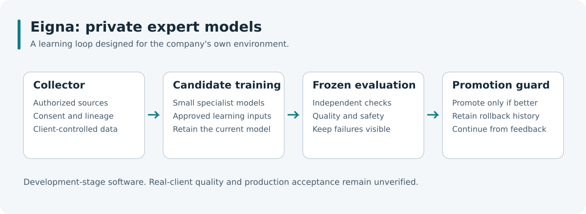

# Eigna Labs

Eigna Labs builds private expert models for companies, designed to run in their own cloud or on their own servers.

## What Eigna supports

Our proof-of-concept software covers:

- Collection from authorized documents and structured records, with consent and source lineage.
- Specialist decision models evaluated against a fixed test set.
- Learning cycles that retain the current model when a candidate fails or does not improve.
- Research scorecards that distinguish measured results, missing evidence and planned work.

The product direction is client-controlled data and models, private deployment and learning from approved feedback. Eigna is being built for organizations worldwide.

## Get started

Visit [eigna.ai](https://eigna.ai) to learn about the product. The [early-access page](https://eigna.ai/waitlist) provides the current registration or email-contact path.

This repository contains the organization profile. Application installation and client onboarding are not available from this repository.

## Status and limits

Eigna is in development. Proofs of concept use synthetic and public data. They do not establish quality on a client's decisions, a complete client installation or production privacy acceptance.

Research forecasts do not establish a trading edge. Planned capabilities and unrun comparisons remain labelled as such. A candidate is promoted only under its evaluation and safety rules; improvement is not guaranteed for every batch.

Questions from your organization: [contact@eigna.ai](mailto:contact@eigna.ai).
