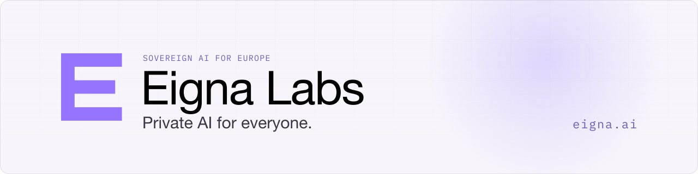
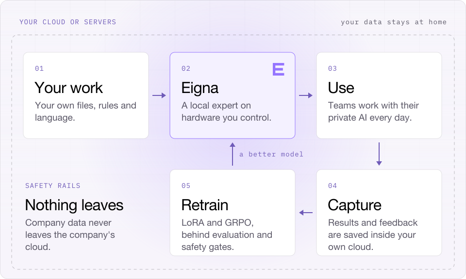

<a href="https://eigna.ai">
  <picture>
    <source media="(prefers-color-scheme: dark)" srcset="./assets/banner-dark.svg">
    <source media="(prefers-color-scheme: light)" srcset="./assets/banner-light.svg">
    
  </picture>
</a>

  Eigna Labs builds <b>Eigna</b>: private, sovereign enterprise AI that runs inside your own cloud or servers and keeps your data at home.

  <a href="https://eigna.ai"><b>eigna.ai</b></a>
  &nbsp;·&nbsp;
  <a href="https://eigna.ai/waitlist"><b>Join the waitlist</b></a>
  &nbsp;·&nbsp;
  <a href="mailto:contact@eigna.ai"><b>contact@eigna.ai</b></a>

## Why Eigna

- **Sovereign.** Your data, your model, your infrastructure. It runs inside your own cloud or servers, and nothing leaves.
- **Specialized.** Trained on your own work, rules and language.
- **Keeps learning.** Gets better every week where it lives, behind safety rails.
- **Owned, not rented.** The model stays the same until you decide.

## How it works

<picture>
  <source media="(prefers-color-scheme: dark)" srcset="./assets/how-it-works-dark.svg">
  <source media="(prefers-color-scheme: light)" srcset="./assets/how-it-works-light.svg">
  
</picture>

1. **Use.** Teams work with their private AI every day.
2. **Capture.** Results and feedback are saved inside their own cloud.
3. **Retrain.** The decision model and the private LLM retrain with LoRA and GRPO, behind evaluation and safety gates.
4. **Improve.** A better model, then the loop starts again.

## Try Eigna

Join the Eigna waitlist for early access at [eigna.ai/waitlist](https://eigna.ai/waitlist). Questions from your company? Write to [contact@eigna.ai](mailto:contact@eigna.ai).

 

  

  <b>Eigna Labs</b> &nbsp;·&nbsp; Private AI for everyone &nbsp;·&nbsp; <a href="https://eigna.ai">eigna.ai</a>

